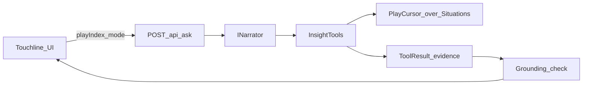

# Insights tools — contract

Typed, read-only analytics behind `POST /api/ask`.
**Code owns every number. The model only chooses tools and writes narrative.**

Parent plan: [HACKATHON-PLAN.md](./HACKATHON-PLAN.md). Loop and receipt shape: [foundry.md](./foundry.md).

Implementation (server-side, `backend/Services/Insights/`):

- Tools: `InsightTools.cs` — one static method per tool, dispatched by `Run(name, …)`
- Track helpers: `PlayCursor.cs` — `ScoreAt`, `MinuteAt`, `StatsAt`, `Kind`, `CardColour`; the
  C# mirror of `src/match/track.js` and `src/match/stats.js`
- Input: `MatchDto.Situations` as returned by `IMatchStore.GetEnrichedMatchAsync`
- Catalog size for `data_limits`: `IMatchStore.GetCatalogAsync` (blob `index.json`)
- Tests: `tests/Touchline.Api.Tests/` — hand-tallied fixture in `MatchFixture.cs`



---

## Shared request context

Every tool call receives (or the host resolves) this context. Tools are **mode-agnostic**: `mode` affects only the agent prompt / post-process tone, never the numbers.

| Field | Type | Notes |
|---|---|---|
| `matchId` | string | Catalog id, e.g. `01-northbridge` |
| `playIndex` | int | Playhead into `playTrack` (≥ 0) |
| `mode` | `analyst` \| `casual` \| `player_focus` | Personalization for the narrator only |
| `favoritePlayer` | string? | Display name as in feed `player` field (e.g. `"Dekker, Niels"`) |
| `windowMinutes` | int? | Default `5` for windowed tools |

Tools read `match.Situations` directly and clamp `playIndex` into range; they never invent rows. `mode`, `supporting`, `focusMetric` and `language` are forwarded to the narrator only.

---

## Shared `ToolResult` shape

```json
{
  "tool": "match_state",
  "facts": [
    { "id": "match_state.score.home", "label": "Home score", "value": 1 },
    { "id": "match_state.possession.home", "label": "Home possession", "value": 55, "unit": "%" }
  ],
  "table": null,
  "chart": null,
  "method": "scoreAt + statsAt possession proxy through playIndex",
  "coverage": "Situations 0..playIndex on synthetic feed 01-northbridge",
  "caveats": ["Possession is phase-row share, not Opta possession."],
  "cannot_tell": ["xG", "pass networks", "player tracking speeds"]
}
```

Rules:

- `facts[].id` is the **evidence ID**. Narratives quote numbers that must match `value` at written precision.
- Return aggregates only — never dump the raw playTrack.
- Every tool sets `cannot_tell` when relevant; `data_limits` is the dedicated scope tool.

---

## Agent loop and grounding

1. **Ask** — `POST /api/ask` with context; question trimmed to 300 chars, blank → "What matters at this playhead?".
2. **Plan** — `FoundryNarrator` exposes the seven tools as chat functions; `RulesNarrator` picks by keyword and `focusMetric`.
3. **Compute** — host runs tools; collects facts + evidence IDs. If the model skips tools, `match_state` is forced so grounding has facts.
4. **Explain** — model returns JSON: `{ narrative, key_evidence_ids, in_scope }`. Non-JSON → rules fallback.
5. **Check** — `Grounding.Check`: every numeric token in `narrative` must equal a tool `value` (question-echoed numbers and evidence IDs exempt; `%` tokens need a `%` fact). No retry: on a miss the narrative is hidden and the evidence kept. Exact rules in [foundry.md](./foundry.md).
6. **Show** — receipt: narrative (or notice), figures, chart, caveats, tools used, measured stage timings, token usage, trace id.

Budgets as implemented:

| Limit | Value |
|---|---|
| Tool-calling turns per answer | ≤ 6 (`FoundryNarrator` loop) |
| Output tokens per turn | ≤ 800 |
| Temperature | 0.2 |
| Narrative length asked of the model | < 360 chars |
| Conversation storage | none; each ask is a fresh message list |

Latency is reported per ask in `stages`; there is no enforced p95 gate yet.

Out-of-scope → call `data_limits`, set `in_scope: false`, explain what the feed cannot answer.

---

## v1 tool registry

| Status | Tool | Job |
|---|---|---|
| ☑ | `match_state` | Score, minute, phase, possession |
| ☑ | `pressure_window` | Control vs chaos over last N minutes |
| ☑ | `key_moment` | Why the current event matters |
| ☑ | `shot_quality` | Shot/goal/save quality heuristic |
| ☑ | `player_spotlight` | Favourite player tally through playhead |
| ☑ | `recap` | HT / FT deterministic bullets |
| ☑ | `data_limits` | Scope and honest refusals |

---

## `match_state`

**TOOL_NAME:** `match_state`

**Description (for the model):** Current match state at the playhead: score, clock minute, attacking phase of the current row, and ball-possession share derived from phase rows.

**Params:**

```json
{ "matchId": "01-northbridge", "playIndex": 120 }
```

(`windowMinutes` unused.)

**Computes from:** `scoreAt(playTrack, playIndex)`, `minuteAt(...)`, current row `phase`, `statsAt` possession tallies.

**Evidence ID pattern:**

| id | value |
|---|---|
| `match_state.score.home` | int |
| `match_state.score.away` | int |
| `match_state.minute` | int |
| `match_state.phase` | `"safe"` \| `"attack"` \| `"dangerous"` \| `null` |
| `match_state.possession.home` | 0–100 |
| `match_state.possession.away` | 0–100 |

**Method:** Possession % = home phase-row count / (home + away) through `playIndex`, same proxy as `statsAt` “Ball possession”.

**Caveats:** Not broadcast Opta possession; phase rows are synthetic situation density.

**Hand-test sketch (Northbridge):** At first goal (`minute` 64, Dekker), expect `score.home = 1`, `score.away = 0`, `minute = 64`. Recompute possession by counting phase rows with `team` home/away up to that `playIndex`.

---

## `pressure_window`

**TOOL_NAME:** `pressure_window`

**Description:** Pressure balance over the last `windowMinutes` of match time ending at the playhead: share of rows in `dangerous` phase per team, and a control vs chaos label.

**Params:**

```json
{ "matchId": "01-northbridge", "playIndex": 120, "windowMinutes": 5 }
```

**Computes from:** playTrack rows with `minute` in `[minuteAt - windowMinutes, minuteAt]` and a `phase` field.

**Evidence ID pattern:**

| id | value |
|---|---|
| `pressure_window.minutes` | int (window used) |
| `pressure_window.dangerous_share.home` | 0–100 |
| `pressure_window.dangerous_share.away` | 0–100 |
| `pressure_window.label` | `"home_control"` \| `"away_control"` \| `"contested"` \| `"chaos"` |

**Method (deterministic):**

- Let `D_h`, `D_a` = dangerous-phase row counts; `T` = all phase rows in window.
- Shares = round(100 * D / T) per team (0 if T = 0).
- Label: if max(D_h, D_a) / T ≥ 0.55 → that side `_control`; if both dangerous shares ≥ 35 → `chaos`; else `contested`.

**Caveats:** Chaos is a label on synthetic phase density, not a physics model.

**Hand-test sketch:** Sparse fixture `07-sparse-stalemate` mid-match → low dangerous shares, label `contested`. Dense `08-high-event` after a flurry → often `chaos` or a clear `_control`.

---

## `key_moment`

**TOOL_NAME:** `key_moment`

**Description:** Explain why the event at `playIndex` matters: incident type, score context before/after if a goal, and preceding pressure from `pressure_window` defaults.

**Params:**

```json
{ "matchId": "01-northbridge", "playIndex": 120, "windowMinutes": 5 }
```

**Computes from:** current row (`incident` / `type`, `team`, `player`, `minute`); `scoreAt` at `playIndex - 1` and `playIndex`; nested call logic equivalent to `pressure_window`.

**Evidence ID pattern:**

| id | value |
|---|---|
| `key_moment.type` | string (e.g. `goal`) |
| `key_moment.team` | `home` \| `away` \| null |
| `key_moment.minute` | int |
| `key_moment.score_before.home` / `.away` | int |
| `key_moment.score_after.home` / `.away` | int |
| `key_moment.salience` | 0–100 int |
| `key_moment.preceding_label` | same enum as pressure_window |

**Salience heuristic (fixed weights):**

| Condition | Add |
|---|---|
| type in `goal` | 40 |
| type in `card` with red / second yellow | 35 |
| type in `card` yellow | 15 |
| type in shot family | 20 |
| type in `injury` / `substitution` | 10 |
| Opens scoring (0-0 → 1-0) | +25 |
| Equalises or retakes lead | +20 |
| Preceding label `chaos` or opponent `_control` | +10 |

Clamp to 0–100.

**Caveats:** Salience is a broadcast ranking aid, not win probability.

**Hand-test sketch:** Northbridge 64' Dekker goal from 0-0 → `salience ≥ 65`, `score_before` 0-0, `score_after` 1-0.

---

## `shot_quality`

**TOOL_NAME:** `shot_quality`

**Description:** Quality and outcome for the shot-related incident at or nearest before `playIndex` (goal, shot on/off/blocked, save).

**Params:**

```json
{ "matchId": "01-northbridge", "playIndex": 120 }
```

**Computes from:** walk back from `playIndex` to nearest shot-family incident; pitch `x`,`y` if present; cumulative `statsAt` shots on target.

**Shot family:** `goal`, `shotontarget`, `shotofftarget`, `shotblocked`, `goalkeeper_saved`.

**Evidence ID pattern:**

| id | value |
|---|---|
| `shot_quality.outcome` | `goal` \| `on_target` \| `off_target` \| `blocked` \| `saved` \| `none` |
| `shot_quality.team` | home/away/null |
| `shot_quality.quality` | 0.00–1.00 (two decimals) |
| `shot_quality.shots_on.home` / `.away` | int through playIndex |

**Quality heuristic:**

- Base by outcome: goal 0.90, on_target/saved 0.70, blocked 0.45, off_target 0.25.
- If `x` present: closer to opposition goal (home attacks +x) adjusts ±0.10 by depth bands; clamp 0–1.
- Round to two decimals for grounding.

**Caveats:** Not xG. No defender positions in feed.

**Hand-test sketch:** Pick a `shotofftarget` in Northbridge; expect `outcome = off_target`, `quality` near 0.25–0.35; shots-on tallies match manual count of goal+shotontarget (+ save attribution per `statsAt`).

---

## `player_spotlight`

**TOOL_NAME:** `player_spotlight`

**Description:** Tally involvement for `favoritePlayer` (exact match on event `player` string) through the playhead: goals, cards, named incidents.

**Params:**

```json
{
  "matchId": "01-northbridge",
  "playIndex": 200,
  "favoritePlayer": "Dekker, Niels"
}
```

**Computes from:** filter playTrack `[0..playIndex]` where `player` equals `favoritePlayer` (trim, case-sensitive as stored).

**Evidence ID pattern:**

| id | value |
|---|---|
| `player_spotlight.name` | string |
| `player_spotlight.events` | int |
| `player_spotlight.goals` | int |
| `player_spotlight.cards` | int |
| `player_spotlight.shots` | int (shot family) |
| `player_spotlight.found` | true/false |

**Caveats:** Feed only names players on some incident types; assists in `text` are not parsed in v1. No speed/distance until feed grows.

**Hand-test sketch:** `favoritePlayer = "Dekker, Niels"` after 64' → `goals ≥ 1`, `found = true`. Unknown name → `found = false`, all counts 0.

---

## `recap`

**TOOL_NAME:** `recap`

**Description:** Deterministic half-time or full-time bullet facts: score, shot and card totals, list of goal scorers with minutes.

**Params:**

```json
{ "matchId": "01-northbridge", "playIndex": 999, "period": "ft" }
```

`period`: `ht` \| `ft` \| `auto` (auto = FT if `match_ended` seen, else HT if first `periodscore`, else “so far”).

**Computes from:** `scoreAt`, `statsAt`, timeline marks for goals with `player` + `minute`.

**Evidence ID pattern:**

| id | value |
|---|---|
| `recap.period` | `ht` \| `ft` \| `live` |
| `recap.score.home` / `.away` | int |
| `recap.shots_on.home` / `.away` | int |
| `recap.cards.home` / `.away` | int |
| `recap.goals_count` | int |
| `recap.goal_N.minute` / `.player` / `.team` | per goal in order |

**Caveats:** Scorer list only includes events with a `player` field.

**Hand-test sketch:** Northbridge FT → score 3-0; three `recap.goal_*` entries; cards match momentum/card events through FT.

---

## `data_limits`

**TOOL_NAME:** `data_limits`

**Description:** What this synthetic feed can and cannot support. Call when the question is about club leagues outside the feed, tactics needing tracking data, or predictions.

**Params:**

```json
{ "matchId": "01-northbridge" }
```

**Computes from:** static catalog of capabilities + which optional fields exist on the loaded match (e.g. any `player` on shots).

**Evidence ID pattern:**

| id | value |
|---|---|
| `data_limits.matches_in_catalog` | int (from catalog / `feeds/matches/index.json`) |
| `data_limits.has_player_names` | bool |
| `data_limits.has_phases` | bool |
| `data_limits.event_types_count` | int |

**always `cannot_tell` includes:** real Premier League footage rights, Opta/StatsBomb parity, xG models, pass networks, press resistance, betting odds, future predictions, women’s/club competitions not in the synthetic pack.

**Hand-test sketch:** Question “Which Premier League team is best at counterattacks?” → agent calls `data_limits`, `in_scope = false`, narrative refuses with catalog match count grounded.

---

## Personalization

| Mode | Tools | Narrator behaviour |
|---|---|---|
| `analyst` | unchanged | Dense; cite evidence IDs in prose sparingly; more caveats |
| `casual` | unchanged | Short; one headline number; plain language |
| `player_focus` | prefer `player_spotlight` + `key_moment` | Lead with favourite player when `found` |

Do not branch tool math on `mode`.

---

## Feed extensions (not v1 tools)

Hackathon brief mentions passes, pressure events, ball/shot speed. **Do not invent tools that imply those fields until the JSON feed has them.**

Planned extensions (when enrich/scenarios grow):

| Field / event | Future tool hook |
|---|---|
| `pass` + distance/accuracy | `pass_quality` |
| explicit `pressure` events | replace phase proxy in `pressure_window` |
| `ball_speed` / `shot_speed` | extend `shot_quality` |
| player `id` + tracking | real distance in `player_spotlight` |

Until then, `data_limits.cannot_tell` must list them.

---

## Eval cases

Covered by `tests/Touchline.Api.Tests` against the in-code fixture (20 rows, Northbridge-shaped):

| Case | Test |
|---|---|
| Opening goal: 0-0 → 1-0 at 64', salience 85, preceding `home_control` | `InsightToolsTests.KeyMoment_opening_goal_*` |
| Plain phase row: `match_action`, salience 0 | `InsightToolsTests.KeyMoment_on_a_plain_phase_row_*` |
| Dekker after 64' → `goals ≥ 1`; unknown name → `found = false` | `InsightToolsTests.PlayerSpotlight_*` |
| HT / FT / live recap period, scorer list | `InsightToolsTests.Recap_*` |
| Betting-odds question → `data_limits`, `in_scope = false` | `AskServiceTests.Out_of_scope_questions_route_to_data_limits` |
| Narrator quotes an invented number → `grounding_fail`, figures kept | `AskServiceTests.Grounding_failure_hides_the_narrative_but_keeps_the_figures` |
| `%` token vs plain token, evidence IDs in prose, decimals, question echo | `GroundingTests` |

Not yet covered: the real Foundry round-trip (needs an endpoint), and a sparse-fixture run
(`07-sparse-stalemate`) — the fixture is dense by design.

---

## Implementation status

- [x] Tools server-side over `Situations` (`InsightTools`, `PlayCursor`)
- [x] Grounding validator with tests
- [x] Hand-computed xUnit per tool on an in-code fixture
- [x] `/api/ask` and `/api/suggest` wired from the studio playhead
- [x] Stage timings and token usage on the receipt
- [ ] Tool parameter schemas: only `pressure_window.windowMinutes` and `player_spotlight.favoritePlayer` are declared to the model; the rest take the request context
- [ ] `GET /v1/tools` registry endpoint
- [ ] Grounding retry before hiding
- [ ] App Insights sink for `traceId`
